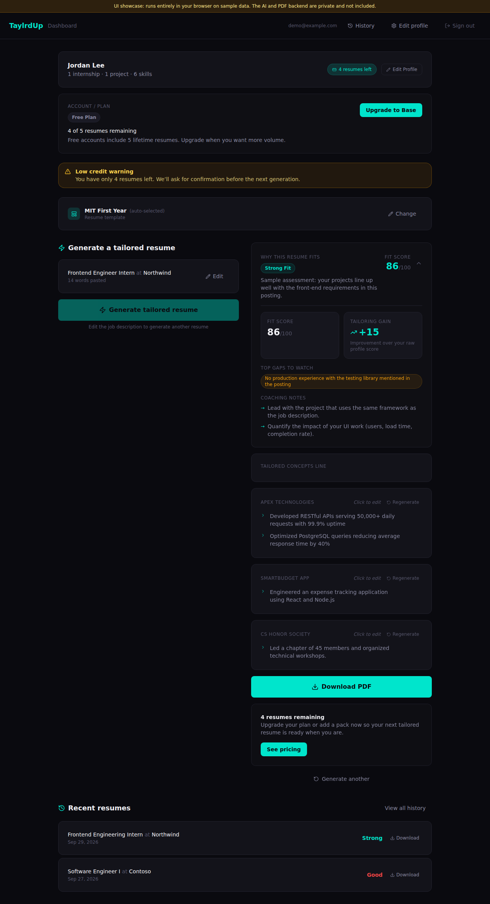

# TaylrdUp: UI Showcase

TaylrdUp is an AI resume-tailoring web app for college students and early-career job seekers. You build one profile, paste a job description, and get a one-page resume tailored to that job, along with a fit score and coaching notes.

**This repo is the front end only, running on sample data.** The full product has a private backend (Python/FastAPI, AI generation, LaTeX-to-PDF compilation, Supabase auth, Stripe payments) that isn't included here. Every API call in this repo goes to a local mock (`src/lib/api.ts`) that keeps the real request and response types, so the UI behaves as it does in production: loading states, errors, credit counts and all.



## What to look at

| Screen | File | What it shows |
|---|---|---|
| Profile builder | `src/app/onboarding/page.tsx` | One scrolling form that replaced an earlier 5-step wizard. You upload a resume to pre-fill it, add sections inline, and a sticky progress bar gates "Generate" on a minimum profile. |
| Dashboard | `src/app/dashboard/page.tsx` | Paste a job description, then see the fit score (before and after tailoring), gaps, coaching notes, and credit states (low-credit warning, out-of-credits banner). |
| Bullet editor | `src/components/BulletEditor.tsx` | Three levels of editing: inline text edits (Enter saves, Esc cancels, edited bullets are highlighted, Restore undoes everything), an AI rewrite of a single bullet that you accept or dismiss, and regenerating a whole section with a preview first. |
| Template picker | `src/components/TemplatePicker.tsx`, `src/lib/template-catalog.ts` | A full-screen modal grouped by field, with a template suggested automatically from the profile. |
| Profile state | `src/lib/profile-store.tsx` | A React context store with typed add/remove/update actions. It auto-saves and waits until the saved profile has loaded before writing, so the empty initial state can't overwrite saved data. |

## UX decisions

- **One page instead of a wizard.** Students jump around, skip sections, and come back later. Everything is visible at once, and each section shows a completion check.
- **Upload first.** Importing an existing resume pre-fills the profile, so users edit instead of typing from scratch. Re-importing offers "Replace existing entries" to avoid duplicates.
- **Minimum requirements are clear.** "Generate" unlocks with name, email, education and one internship or project. Everything else is marked optional, and a "What to add next" card points to the most useful next step.
- **Validation happens at the form level.** Each add-form's submit button stays disabled until its required fields are filled, instead of showing errors after the user submits.
- **Users can review AI output before accepting it.** AI rewrites appear as suggestions to accept or dismiss, never silent replacements.

## Tech stack

Next.js 15 (App Router) · React 18 · TypeScript (strict) · Tailwind CSS · lucide-react

## Run it locally

```bash
npm install
npm run dev
# open http://localhost:3000/onboarding and use "Upload your resume" (any PDF works; it loads a sample profile)
```

No environment variables or API keys are needed.

## What's intentionally left out

The backend, AI prompts, generation and validation pipeline, PDF compilation, auth, payments and admin tools. Links to those pages (sign-in, pricing, history) show a "Not part of this demo" page. The **Download PDF** button opens a sample template preview instead.

## About me

I designed and built TaylrdUp on my own, front end and back end, using AI coding assistants as a pair programmer. I'm happy to walk through the full private codebase on a call.

**Aslam Aliyu**

---

© 2026 Aslam Aliyu. All rights reserved. Shared for evaluation only; see [LICENSE](LICENSE).
